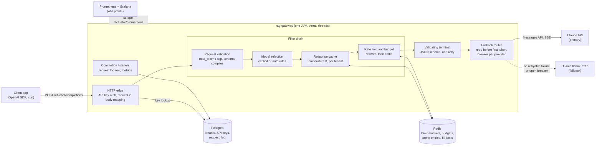

# rag-gateway

An LLM gateway with an OpenAI-compatible `POST /v1/chat/completions` endpoint, built in Java 21 and Spring Boot 3. A RAG endpoint on top of it is the next milestone (see [Status](#status)).

## What it is

One service between applications and LLM providers, so that limits, failures, cost and keys are handled once instead of in every app. An app switches to it by changing its OpenAI base URL.

On every chat request the gateway:

- authenticates the API key and resolves the tenant (the tenant never comes from the body);
- validates the request, including the caller's JSON schema;
- picks the model (`"model": "auto"` uses size-based routing rules);
- serves exact repeats of `temperature: 0` requests from a per-tenant Redis cache;
- enforces a per-tenant token bucket (429 with `Retry-After`) and a monthly budget;
- calls the provider with timeouts, retries before the first token, a circuit breaker per provider and a fallback chain (Claude, then a local Ollama model);
- validates the output against the caller's JSON schema when one is given;
- streams the answer as OpenAI-style SSE, then writes one cost row per request to Postgres and records Prometheus metrics.

### Status

| Part | State |
|---|---|
| Gateway path (t01–t07): auth, rate limit, budget, cost log, fallback, metrics, cache, routing, output validation | Built and tested (JUnit 5 + Testcontainers, WireMock providers) |
| Benchmarks (t08) | k6 harness against WireMock mocks; one committed run on a cloud container (see [Measured](#measured)); laptop run pending |
| RAG ingestion (t09): document API, outbox, chunking, embeddings into pgvector | Built and tested; embeddings here come from a deterministic fake (Ollama is not reachable in the build environment), the Ollama adapter is tested against WireMock |
| RAG path (t10–t13): hybrid retrieval, ACL filtering, evals | Not built yet |

## Quickstart

Needs Docker and a JDK 21. This runs against WireMock mock providers (the `mock` compose profile starts `mock-claude` on port 8081 and `mock-ollama` on port 8082; the `bench` Spring profile points the providers at them), so no API key is needed.

<!-- quickstart:begin -->
```bash
docker compose --profile mock up -d --wait
./gradlew bootRun --args='--spring.profiles.active=bench'
export RGW_KEY=$(scripts/seed-demo.sh | awk '$1 == "acme" && $2 == "admin" { print $NF }')
curl -sS http://localhost:8080/v1/chat/completions -H "Authorization: Bearer $RGW_KEY" -H 'Content-Type: application/json' -d '{"model":"auto","messages":[{"role":"user","content":"Say hi"}]}'
```
<!-- quickstart:end -->

`bootRun` stays in the foreground; run the last two commands in a second terminal once it logs `Started`. `scripts/seed-demo.sh` creates two tenants and three keys and prints the keys once; only their SHA-256 is stored.

Against the real Claude API instead: copy `.env.example` to `.env`, set `GATEWAY_CLAUDE_API_KEY`, export it in the shell that runs the app, start the stack with `docker compose up -d` (Postgres and Redis only) and run `./gradlew bootRun` without the `bench` profile. The fallback needs a local Ollama with `llama3.2:1b` pulled.

`bash scripts/quickstart_check.sh` runs exactly the four commands above on a clean clone and expects a 200.

## Architecture



### Request path

1. **Auth (edge).** `Authorization: Bearer <key>`; the key's SHA-256 is looked up in Postgres. Unknown key: 401, no provider call.
2. **Body mapping and validation.** OpenAI request to the internal request; unsupported fields (`tools`, `n` ≠ 1, images) are a 400. `max_tokens` is capped and a `json_schema` response format must compile.
3. **Model selection.** An explicit model must be in the catalog and allowed for the tenant (400 or 403). `auto` goes through ordered routing rules; the chosen rule is in `X-Gateway-Route-Rule`.
4. **Cache.** Only `temperature: 0` without `X-Gateway-Cache-Bypass: true` is eligible. The key holds the tenant, the resolved model, the messages, the sampling parameters and the schema. A hit is replayed and never touches the limiter. A cold key is filled by one request holding a Redis lock while the others wait.
5. **Rate limit and budget.** Reserve `input estimate + max_tokens` from the tenant's token bucket (Lua script in Redis): denied is 429 `rate_limited` with `Retry-After`. Month-to-date spend at or over the budget is 429 `budget_exceeded`. After the call, unused tokens are refunded and the cost is added, exactly once, in a `finally` block.
6. **Router.** Per provider: `Retry(CircuitBreaker(call))`, retrying only before the first token with full-jitter backoff; on a retryable failure or an open breaker, the next provider in the chain. Timeouts (connect, first token, idle gap) live in the adapters.
7. **Output validation.** With a schema, each router call is buffered, checked (schema, truncation, refusal), retried once, and sent as one burst or a 502 `invalid_model_output`. Without one, tokens stream straight through; a structural check per attempt turns an empty `stop` answer into a retryable failure.
8. **Response, log, metrics.** SSE or JSON to the client with `X-Request-Id`, `X-Gateway-Provider`, `X-Gateway-Model`, `X-Gateway-Cache`. After the response is closed, one `request_log` row (tokens, cost, provider, cache status, attempts) and the request metrics.

## API examples

Streaming chat (any OpenAI client works the same way):

```bash
curl -N http://localhost:8080/v1/chat/completions \
  -H "Authorization: Bearer $RGW_KEY" -H 'Content-Type: application/json' \
  -d '{"model":"claude-haiku-5-5","stream":true,"stream_options":{"include_usage":true},
       "messages":[{"role":"user","content":"Say hi"}]}'
```

Routed model, cacheable (`temperature: 0`), headers shown:

```bash
curl -sS -D - http://localhost:8080/v1/chat/completions \
  -H "Authorization: Bearer $RGW_KEY" -H 'Content-Type: application/json' \
  -d '{"model":"auto","temperature":0,"messages":[{"role":"user","content":"Name a prime number"}]}'
# X-Gateway-Route-Rule: short   X-Gateway-Model: claude-haiku-5-5   X-Gateway-Cache: MISS, then HIT on a repeat
```

Structured output, validated against the caller's schema (a non-conforming answer is retried once, then 502):

```bash
curl -sS http://localhost:8080/v1/chat/completions \
  -H "Authorization: Bearer $RGW_KEY" -H 'Content-Type: application/json' \
  -d '{"model":"claude-opus-5-5","messages":[{"role":"user","content":"Capital of France as JSON"}],
       "response_format":{"type":"json_schema","json_schema":{"name":"city","schema":{
         "type":"object","required":["city"],"properties":{"city":{"type":"string"}}}}}}'
```

Usage and cost of the caller's tenant (dates are UTC days, `to` exclusive; default: this month):

```bash
curl -sS "http://localhost:8080/v1/usage?from=2026-11-01&to=2026-12-01" -H "Authorization: Bearer $RGW_KEY"
# {"tenant_id":"acme","from":"2026-11-01","to":"2026-12-01","requests":..,"input_tokens":..,"output_tokens":..,"cost_usd":".."}
```

OpenAI Python SDK:

```python
import os
from openai import OpenAI
client = OpenAI(base_url="http://localhost:8080/v1", api_key=os.environ["RGW_KEY"])
for chunk in client.chat.completions.create(model="auto", stream=True,
                                            messages=[{"role": "user", "content": "Say hi"}]):
    print(chunk.choices[0].delta.content or "", end="")
```

Errors are OpenAI-shaped JSON (`{"error":{"message","type","code","request_id"}}`) before the first byte, and an SSE `error` event after it. Main codes: 401 bad key, 400 invalid request, 403 `model_not_allowed`, 429 `rate_limited` (with `Retry-After`) or `budget_exceeded`, 502 `invalid_model_output`, 503 `all_providers_failed`.

`bash scripts/demo.sh` runs the main behaviours end to end against the mock profile: a 429 with `Retry-After`, a cache hit, a fallback with the Claude mock stopped, a schema-validated answer (and a non-conforming one retried once, then 502) and `/v1/usage`, printing what each step expects and what it got. It needs the mock stack and the app running (quickstart steps 1 and 2), creates its own demo tenants, and restarts the Claude mock when it ends.

## Designed for

Design assumptions and targets from the [HLD](docs/HLD.md) and DECISIONS C2. **None of these is a measurement**, and nothing here is evidence that the gateway reaches them.

<!-- designed-for:begin -->
| Quantity | Assumption or target | Source |
|---|---|---|
| Average request rate | ~300 requests/s | C2 |
| Peak request rate | ~900 requests/s | C2 |
| Requests in flight at peak | ~4K (900 req/s × ~4.5 s per streamed answer) | C2 |
| Output tokens at peak | ~450K tokens/s (900 × ~500) | C2 |
| Gateway added latency before the first token | target < 50 ms p99 | HLD non-functional requirements |
| Cache-hit latency | target p99 < 200 ms | project brief, WORK_PLAN t08 |
| Availability | target 99.9 %, survives one provider outage | HLD non-functional requirements |
<!-- designed-for:end -->

The binding constraints at that scale are concurrency and tokens, not request rate: that is why requests run on virtual threads and limits are counted in tokens.

## Measured

Every value below is read from a committed run file, `bench/summary/<Run>.json`, at the key in the last column; `python3 scripts/check_readme_numbers.py` fails if any value, label or key disagrees. Rows start with the scenario number (S1 to S8) used in the run file's setup notes and in [the work plan](docs/process/WORK_PLAN.md).

How to read it:

- **Hardware.** "cloud container, 4 vCPU / 15 GB" ran the gateway, the WireMock mocks, Redis, Postgres and k6 on the same host, sharing its CPUs. That inflates latency and caps throughput, so these numbers say what the gateway adds on that machine, not how it behaves against real providers (the mocks have fixed latency and never rate-limit). Laptop runs are added as their own rows by the owner and replace nothing; none exists yet.
- **Setup.** App with `-Xmx512m` and virtual threads; k6 `grafana/k6:2.3.0` with an open arrival-rate model for latency scenarios and a closed model for open streams (D-45). The mocks send the first chunk (holding the first token) after a fixed delay and the rest over about a second; the run file's `setup.mock_latency` has the exact shape.
- **Percentiles.** "k6 client-side" percentiles are computed by k6 from every request. "bucket edges" percentiles come from a Prometheus histogram and are interpolated inside the bucket that holds them (D-38), so they are estimates; the row lists the edges.
- **Added latencies are differences of percentiles**, not percentiles of differences: "p99 added" is the gateway leg's p99 minus the comparison leg's p99. Tails are noisy on a shared host, and the differences need not grow from p50 to p99.

<!-- measured:begin -->
| Metric | Value | Unit | Measured on | Run | Source key |
|---|---|---|---|---|---|
| S1 Overhead: requests through the gateway | 11,001 | requests | cloud container, 4 vCPU / 15 GB | 20261116T2232Z-cloud-container-4-vcpu-15-gb | `scenarios.overhead.requests` |
| S1 Added latency seen by the client, time to first byte, p50 (gateway minus direct, k6 client-side) | 1.7 | ms | cloud container, 4 vCPU / 15 GB | 20261116T2232Z-cloud-container-4-vcpu-15-gb | `scenarios.overhead.added_latency_seen_by_client_ms.ttfb.p50` |
| S1 Added latency seen by the client, time to first byte, p95 (gateway minus direct, k6 client-side) | 3.5 | ms | cloud container, 4 vCPU / 15 GB | 20261116T2232Z-cloud-container-4-vcpu-15-gb | `scenarios.overhead.added_latency_seen_by_client_ms.ttfb.p95` |
| S1 Added latency seen by the client, time to first byte, p99 (gateway minus direct, k6 client-side) | 5.2 | ms | cloud container, 4 vCPU / 15 GB | 20261116T2232Z-cloud-container-4-vcpu-15-gb | `scenarios.overhead.added_latency_seen_by_client_ms.ttfb.p99` |
| S1 Added latency seen by the client, total time, p50 (gateway minus direct, k6 client-side) | 1.8 | ms | cloud container, 4 vCPU / 15 GB | 20261116T2232Z-cloud-container-4-vcpu-15-gb | `scenarios.overhead.added_latency_seen_by_client_ms.total.p50` |
| S1 Added latency seen by the client, total time, p95 (gateway minus direct, k6 client-side) | 3.9 | ms | cloud container, 4 vCPU / 15 GB | 20261116T2232Z-cloud-container-4-vcpu-15-gb | `scenarios.overhead.added_latency_seen_by_client_ms.total.p95` |
| S1 Added latency seen by the client, total time, p99 (gateway minus direct, k6 client-side) | 16.4 | ms | cloud container, 4 vCPU / 15 GB | 20261116T2232Z-cloud-container-4-vcpu-15-gb | `scenarios.overhead.added_latency_seen_by_client_ms.total.p99` |
| S1 Gateway processing overhead, p50 (`gateway_overhead_seconds`, bucket edges 1, 2, 5, 10, 25, 50, 100, 250, 500, 1000 ms) | 1.7 | ms | cloud container, 4 vCPU / 15 GB | 20261116T2232Z-cloud-container-4-vcpu-15-gb | `scenarios.overhead.gateway_processing_overhead_ms.p50` |
| S1 Gateway processing overhead, p95 (`gateway_overhead_seconds`, bucket edges 1, 2, 5, 10, 25, 50, 100, 250, 500, 1000 ms) | 4.5 | ms | cloud container, 4 vCPU / 15 GB | 20261116T2232Z-cloud-container-4-vcpu-15-gb | `scenarios.overhead.gateway_processing_overhead_ms.p95` |
| S1 Gateway processing overhead, p99 (`gateway_overhead_seconds`, bucket edges 1, 2, 5, 10, 25, 50, 100, 250, 500, 1000 ms) | 6.1 | ms | cloud container, 4 vCPU / 15 GB | 20261116T2232Z-cloud-container-4-vcpu-15-gb | `scenarios.overhead.gateway_processing_overhead_ms.p99` |
| S8 Request-log insert, p50 (`gateway_requestlog_write_seconds`, bucket edges 0.5, 1, 2, 5, 10, 25, 50, 100 ms) | 0.8 | ms | cloud container, 4 vCPU / 15 GB | 20261116T2232Z-cloud-container-4-vcpu-15-gb | `scenarios.log_insert.p50_ms` |
| S8 Request-log insert, p99 (`gateway_requestlog_write_seconds`, bucket edges 0.5, 1, 2, 5, 10, 25, 50, 100 ms) | 4.0 | ms | cloud container, 4 vCPU / 15 GB | 20261116T2232Z-cloud-container-4-vcpu-15-gb | `scenarios.log_insert.p99_ms` |
| S8 Request-log inserts measured | 11,001 | count | cloud container, 4 vCPU / 15 GB | 20261116T2232Z-cloud-container-4-vcpu-15-gb | `scenarios.log_insert.count` |
| S2 Cache-hit latency, total time, p50 (k6 client-side) | 1.3 | ms | cloud container, 4 vCPU / 15 GB | 20261116T2232Z-cloud-container-4-vcpu-15-gb | `scenarios.cache_hit_latency.p50_ms` |
| S2 Cache-hit latency, total time, p95 (k6 client-side) | 1.9 | ms | cloud container, 4 vCPU / 15 GB | 20261116T2232Z-cloud-container-4-vcpu-15-gb | `scenarios.cache_hit_latency.p95_ms` |
| S2 Cache-hit latency, total time, p99 (k6 client-side) | 3.3 | ms | cloud container, 4 vCPU / 15 GB | 20261116T2232Z-cloud-container-4-vcpu-15-gb | `scenarios.cache_hit_latency.p99_ms` |
| S2 Cache-hit latency: requests | 2,000 | requests | cloud container, 4 vCPU / 15 GB | 20261116T2232Z-cloud-container-4-vcpu-15-gb | `scenarios.cache_hit_latency.requests` |
| S3 Cache hit rate: configured repeat share of the workload | 50.0 | % | cloud container, 4 vCPU / 15 GB | 20261116T2232Z-cloud-container-4-vcpu-15-gb | `scenarios.cache_hit_rate.configured_repeat_share` |
| S3 Cache hit rate: measured | 48.1 | % | cloud container, 4 vCPU / 15 GB | 20261116T2232Z-cloud-container-4-vcpu-15-gb | `scenarios.cache_hit_rate.measured_hit_rate` |
| S3 Cache hit rate: requests | 1,001 | requests | cloud container, 4 vCPU / 15 GB | 20261116T2232Z-cloud-container-4-vcpu-15-gb | `scenarios.cache_hit_rate.requests` |
| S4 Cost per 1,000 requests, baseline: explicit strong model, no cache (modelled from list prices on a synthetic workload) | 7.7200 | USD | cloud container, 4 vCPU / 15 GB | 20261116T2232Z-cloud-container-4-vcpu-15-gb | `scenarios.cost_per_1k.baseline_usd` |
| S4 Cost per 1,000 requests, cache only (modelled from list prices on a synthetic workload) | 4.0144 | USD | cloud container, 4 vCPU / 15 GB | 20261116T2232Z-cloud-container-4-vcpu-15-gb | `scenarios.cost_per_1k.cache_usd` |
| S4 Cost per 1,000 requests, routing only (modelled from list prices on a synthetic workload) | 3.5080 | USD | cloud container, 4 vCPU / 15 GB | 20261116T2232Z-cloud-container-4-vcpu-15-gb | `scenarios.cost_per_1k.routing_usd` |
| S4 Cost per 1,000 requests, cache and routing (modelled from list prices on a synthetic workload) | 1.8242 | USD | cloud container, 4 vCPU / 15 GB | 20261116T2232Z-cloud-container-4-vcpu-15-gb | `scenarios.cost_per_1k.cache_and_routing_usd` |
| S4 Cost: requests per run | 1,000 | requests | cloud container, 4 vCPU / 15 GB | 20261116T2232Z-cloud-container-4-vcpu-15-gb | `scenarios.cost_per_1k.requests_per_run` |
| S5 Fallback: Claude mock killed at (seconds after the run started) | 24.8 | s | cloud container, 4 vCPU / 15 GB | 20261116T2232Z-cloud-container-4-vcpu-15-gb | `scenarios.fallback.primary_killed_at_s` |
| S5 Fallback: requests started after the kill | 705 | requests | cloud container, 4 vCPU / 15 GB | 20261116T2232Z-cloud-container-4-vcpu-15-gb | `scenarios.fallback.requests_after_kill` |
| S5 Fallback: success rate after the kill | 100.0 | % | cloud container, 4 vCPU / 15 GB | 20261116T2232Z-cloud-container-4-vcpu-15-gb | `scenarios.fallback.success_rate_after_kill` |
| S5 Fallback: added latency after the kill, p50 (successful after minus before, k6 client-side) | 2.0 | ms | cloud container, 4 vCPU / 15 GB | 20261116T2232Z-cloud-container-4-vcpu-15-gb | `scenarios.fallback.added_latency_ms.p50` |
| S5 Fallback: added latency after the kill, p95 (successful after minus before, k6 client-side) | 4.2 | ms | cloud container, 4 vCPU / 15 GB | 20261116T2232Z-cloud-container-4-vcpu-15-gb | `scenarios.fallback.added_latency_ms.p95` |
| S5 Fallback: added latency after the kill, p99 (successful after minus before, k6 client-side) | 15.7 | ms | cloud container, 4 vCPU / 15 GB | 20261116T2232Z-cloud-container-4-vcpu-15-gb | `scenarios.fallback.added_latency_ms.p99` |
| S6 Rate limit: over-limit requests | 1,032 | requests | cloud container, 4 vCPU / 15 GB | 20261116T2232Z-cloud-container-4-vcpu-15-gb | `scenarios.rate_limit.over_limit_requests` |
| S6 Rate limit: over-limit requests answered 429 with `Retry-After` | 1,032 | requests | cloud container, 4 vCPU / 15 GB | 20261116T2232Z-cloud-container-4-vcpu-15-gb | `scenarios.rate_limit.with_429_and_retry_after` |
| S6 Rate limit: share answered correctly | 100.0 | % | cloud container, 4 vCPU / 15 GB | 20261116T2232Z-cloud-container-4-vcpu-15-gb | `scenarios.rate_limit.share_correct` |
| S6 Rate limit: admitted tokens per minute (second minute of the run) | 19,950 | tokens/min | cloud container, 4 vCPU / 15 GB | 20261116T2232Z-cloud-container-4-vcpu-15-gb | `scenarios.rate_limit.admitted_tokens_per_min` |
| S6 Rate limit: configured limit | 20,000 | tokens/min | cloud container, 4 vCPU / 15 GB | 20261116T2232Z-cloud-container-4-vcpu-15-gb | `scenarios.rate_limit.limit_tokens_per_min` |
| S6b Redis refused from start: added latency, p50 (vs scenario 1, k6 client-side) | 0.8 | ms | cloud container, 4 vCPU / 15 GB | 20261116T2232Z-cloud-container-4-vcpu-15-gb | `scenarios.redis_down_from_start.refused.added_ms.p50` |
| S6b Redis refused from start: added latency, p95 (vs scenario 1, k6 client-side) | 615.8 | ms | cloud container, 4 vCPU / 15 GB | 20261116T2232Z-cloud-container-4-vcpu-15-gb | `scenarios.redis_down_from_start.refused.added_ms.p95` |
| S6b Redis refused from start: added latency, p99 (vs scenario 1, k6 client-side) | 935.5 | ms | cloud container, 4 vCPU / 15 GB | 20261116T2232Z-cloud-container-4-vcpu-15-gb | `scenarios.redis_down_from_start.refused.added_ms.p99` |
| S6b Redis refused from start: requests | 2,986 | requests | cloud container, 4 vCPU / 15 GB | 20261116T2232Z-cloud-container-4-vcpu-15-gb | `scenarios.redis_down_from_start.refused.requests` |
| S6b Redis refused from start: errors | 0 | errors | cloud container, 4 vCPU / 15 GB | 20261116T2232Z-cloud-container-4-vcpu-15-gb | `scenarios.redis_down_from_start.refused.errors` |
| S6b Redis black-holed from start: added latency, p50 (vs scenario 1, k6 client-side; lower bound, capped by k6's request timeout) | 58696.4 | ms | cloud container, 4 vCPU / 15 GB | 20261116T2232Z-cloud-container-4-vcpu-15-gb | `scenarios.redis_down_from_start.blackholed.added_ms.p50` |
| S6b Redis black-holed from start: added latency, p95 (vs scenario 1, k6 client-side; lower bound, capped by k6's request timeout) | 58691.6 | ms | cloud container, 4 vCPU / 15 GB | 20261116T2232Z-cloud-container-4-vcpu-15-gb | `scenarios.redis_down_from_start.blackholed.added_ms.p95` |
| S6b Redis black-holed from start: added latency, p99 (vs scenario 1, k6 client-side; lower bound, capped by k6's request timeout) | 58675.4 | ms | cloud container, 4 vCPU / 15 GB | 20261116T2232Z-cloud-container-4-vcpu-15-gb | `scenarios.redis_down_from_start.blackholed.added_ms.p99` |
| S6b Redis black-holed from start: requests | 1,657 | requests | cloud container, 4 vCPU / 15 GB | 20261116T2232Z-cloud-container-4-vcpu-15-gb | `scenarios.redis_down_from_start.blackholed.requests` |
| S6b Redis black-holed from start: errors (not completed) | 1,386 | errors | cloud container, 4 vCPU / 15 GB | 20261116T2232Z-cloud-container-4-vcpu-15-gb | `scenarios.redis_down_from_start.blackholed.errors` |
| S7 Open streams: largest N with zero errors (`-Xmx512m`) | 2,000 | streams | cloud container, 4 vCPU / 15 GB | 20261116T2232Z-cloud-container-4-vcpu-15-gb | `scenarios.open_streams.max_n_zero_errors` |
| S7 Open streams at N = 500: errors | 0 | errors | cloud container, 4 vCPU / 15 GB | 20261116T2232Z-cloud-container-4-vcpu-15-gb | `scenarios.open_streams.runs[n=500].errors` |
| S7 Open streams at N = 500: peak heap used | 293.9 | MB | cloud container, 4 vCPU / 15 GB | 20261116T2232Z-cloud-container-4-vcpu-15-gb | `scenarios.open_streams.runs[n=500].peak_heap_used_mb` |
| S7 Open streams at N = 500: peak virtual threads (thread dump every 2 s) | 760 | threads | cloud container, 4 vCPU / 15 GB | 20261116T2232Z-cloud-container-4-vcpu-15-gb | `scenarios.open_streams.runs[n=500].peak_virtual_threads` |
| S7 Open streams at N = 500: pinned-thread reports | 16 | count | cloud container, 4 vCPU / 15 GB | 20261116T2232Z-cloud-container-4-vcpu-15-gb | `scenarios.open_streams.runs[n=500].pinned_reports` |
| S7 Open streams at N = 1000: errors | 0 | errors | cloud container, 4 vCPU / 15 GB | 20261116T2232Z-cloud-container-4-vcpu-15-gb | `scenarios.open_streams.runs[n=1000].errors` |
| S7 Open streams at N = 1000: peak heap used | 510.0 | MB | cloud container, 4 vCPU / 15 GB | 20261116T2232Z-cloud-container-4-vcpu-15-gb | `scenarios.open_streams.runs[n=1000].peak_heap_used_mb` |
| S7 Open streams at N = 1000: peak virtual threads (thread dump every 2 s) | 1,382 | threads | cloud container, 4 vCPU / 15 GB | 20261116T2232Z-cloud-container-4-vcpu-15-gb | `scenarios.open_streams.runs[n=1000].peak_virtual_threads` |
| S7 Open streams at N = 1000: pinned-thread reports | 0 | count | cloud container, 4 vCPU / 15 GB | 20261116T2232Z-cloud-container-4-vcpu-15-gb | `scenarios.open_streams.runs[n=1000].pinned_reports` |
| S7 Open streams at N = 2000: errors | 0 | errors | cloud container, 4 vCPU / 15 GB | 20261116T2232Z-cloud-container-4-vcpu-15-gb | `scenarios.open_streams.runs[n=2000].errors` |
| S7 Open streams at N = 2000: peak heap used | 499.5 | MB | cloud container, 4 vCPU / 15 GB | 20261116T2232Z-cloud-container-4-vcpu-15-gb | `scenarios.open_streams.runs[n=2000].peak_heap_used_mb` |
| S7 Open streams at N = 2000: peak virtual threads (thread dump every 2 s) | 3,223 | threads | cloud container, 4 vCPU / 15 GB | 20261116T2232Z-cloud-container-4-vcpu-15-gb | `scenarios.open_streams.runs[n=2000].peak_virtual_threads` |
| S7 Open streams at N = 2000: pinned-thread reports | 0 | count | cloud container, 4 vCPU / 15 GB | 20261116T2232Z-cloud-container-4-vcpu-15-gb | `scenarios.open_streams.runs[n=2000].pinned_reports` |
| S7b Headers delayed past the first-token timeout: concurrent requests | 1,000 | requests | cloud container, 4 vCPU / 15 GB | 20261116T2232Z-cloud-container-4-vcpu-15-gb | `scenarios.open_streams.headers_delayed.n` |
| S7b Headers delayed: errors | 0 | errors | cloud container, 4 vCPU / 15 GB | 20261116T2232Z-cloud-container-4-vcpu-15-gb | `scenarios.open_streams.headers_delayed.errors` |
| S7b Headers delayed: fallback success rate | 100.0 | % | cloud container, 4 vCPU / 15 GB | 20261116T2232Z-cloud-container-4-vcpu-15-gb | `scenarios.open_streams.headers_delayed.fallback_success_rate` |
| S7b Headers delayed: peak heap used | 484.4 | MB | cloud container, 4 vCPU / 15 GB | 20261116T2232Z-cloud-container-4-vcpu-15-gb | `scenarios.open_streams.headers_delayed.peak_heap_used_mb` |
| S7b Headers delayed: peak virtual threads (thread dump every 2 s) | 2,004 | threads | cloud container, 4 vCPU / 15 GB | 20261116T2232Z-cloud-container-4-vcpu-15-gb | `scenarios.open_streams.headers_delayed.peak_virtual_threads` |
<!-- measured:end -->

Notes on the rows:

- **S1 and S8, overhead.** Two numbers, never merged (D-39, D-45). *Added latency seen by the client* is k6's time to first byte (`http_req_waiting`, which is the first token here) and total time through the gateway, minus the same against the mock directly at the same arrival rate. *Gateway processing overhead* is the gateway's own work measured inside the process (`gateway_overhead_seconds`, excluding provider time and deliberate waits such as retry backoff); its percentiles are interpolated within the listed bucket edges, so a p99 between two edges is only known to lie in that bucket. A gateway warm-up ran first and is not reported. The request-log insert (S8) is timed over the same gateway leg and happens after the response is closed (C7), so it is not in the client's latency.
- **S2 and S3, cache.** Hit latency is the total time of responses marked `X-Gateway-Cache: HIT`, after the prompt pool was warmed. The measured hit rate is below the configured repeat share because each pool prompt's first occurrence is a miss.
- **S4, cost.** Modelled from list prices dated 2026-11-16 (`setup.price_date`) on a synthetic workload: `SUM(request_log.cost_usd)` per run, one fresh tenant per run. Not a bill. The workload (prompt mix, output length, which models) is in the run file under `scenarios.cost_per_1k.workload`.
- **S5, fallback.** The Claude mock was killed with SIGKILL mid-run. Requests are classed by start time; the requests in flight at the moment of the kill failed and are not in the after-kill count. Every successful after-kill request was served by Ollama.
- **S6, rate limit.** One tenant driven above its tokens-per-minute limit. Admitted tokens per minute are counted over the second minute only, because the bucket starts full and the first minute also admits the initial capacity.
- **S6b, Redis unavailable from the start** (decides the D-17 skip window). *Refused*: the median adds little, but p95 and p99 are much higher than p50. *Black-holed* (connections time out with no answer): most requests never completed, they ended at k6's request timeout, so the added-latency values are **lower bounds** capped by that timeout, and k6 could not hold the arrival rate (it dropped scheduled arrivals for lack of free virtual users). The black-holed rows show that a black-holed Redis made the gateway unusable without a skip window. **The skip window was added after this run** (D-46: after a Redis failure every Redis user skips Redis for a second, then one request probes), so these rows describe the code before it; the next run re-measures them, and no new figures are given here until then.
- **S7, open streams.** Closed model: N virtual users each holding one ~5 s stream at a time, app at `-Xmx512m`. The largest step with zero errors is the one in the table; the next step (twice as many streams) ran out of heap (`OutOfMemoryError`), every stream in it failed, and its heap and thread peaks could not be sampled, so it has no rows. From N = 1000 up the peak heap sits close to the 512 MB limit, so heap, not threads, is what bounds this step size. Since this run the gateway sheds load instead of running out of heap: each instance serves at most `gateway.max-in-flight` concurrent `/v1` requests (a configured limit derived from this run, not a measurement) and answers the next one with 503 `overloaded` and `Retry-After: 1` (D-46). Peak heap is sampled every 0.5 s; peak virtual threads come from a thread dump every 2 s (`jvm_threads_live` counts platform threads only), so short peaks between dumps are missed. Pinning reports (`-Djdk.tracePinnedThreads=short`) appeared only right after startup, all in a lazy initializer inside the provider SDK (`kotlin.SynchronizedLazyImpl.getValue`), not in steady-state streaming.
- **S7b, headers delayed.** The Claude mock holds its response headers past the first-token timeout; every request was answered by the Ollama fallback, and the abandoned Claude calls (D-37 c) stayed within the heap at this N.

## Trade-offs

| Choice | Taken | Rejected, and why | Decision |
|---|---|---|---|
| Rate-limit algorithm | Token bucket in one Lua script; reserve `input estimate + max_tokens`, settle to actual | Sliding-window log (memory grows with traffic); fixed window (2× burst at the edge) | C5 |
| Redis down | Fail open: per-instance in-memory bucket, budget check skipped, cache reads as a miss | Fail closed (one Redis outage takes every LLM call down) | D-17 |
| Cache key | Tenant + resolved model + messages + sampling params + schema; `stream` left out | Cross-tenant sharing (higher hit rate, leaks answers); `stream` in the key (halves hits) | D-40 |
| What is cached | Complete primary answers only, `temperature: 0` only | Caching fallback answers (a 1B answer served for the whole TTL) or refusals | C21, D-40 |
| Fallback trigger | Retryable errors and timeouts, plus an open breaker; config faults (401/403/404) move on without retry | Retrying config faults; a hand-written breaker next to Resilience4j | D-07, D-37 |
| Retries mid-stream | Only before the first token reached the client | Retrying after tokens were sent (the client would see duplicated text) | D-07 |
| Output validation vs streaming | Buffer only when a schema is given; one retry; 502 after | Validate after streaming (bad output already sent); JSON repair (hides model errors) | C8, D-43 |
| Cost logging | One insert per request after the response is closed | In-memory batch buffer (loss window and shutdown draining for no measured need yet) | C7 |
| Concurrency model | Spring MVC on virtual threads, blocking code | WebFlux end to end (harder to write and debug for the same I/O-bound scaling) | D-03 |

## Limitations

- **Temperature is not sent to Claude (D-05).** On the API version the SDK uses, a Messages request with `temperature` or `top_p` is rejected, so the gateway forwards them to Ollama only. For Claude, `temperature: 0` is not a determinism guarantee: the cache rule "only `temperature: 0` is cached" is a contract with the caller ("I accept a stored answer"), not a promise that the model would have answered the same way.
- **One price tier per model (D-08).** Prices are configuration with one input and one output price per model. Haiku prompts above 100K tokens are priced higher by the provider and are under-costed here; requests in this project stay far below that.
- **Redis down means fail open (D-17).** With Redis unreachable each instance falls back to its own in-memory bucket, so N instances admit up to N × the tenant's limit, and spend during the outage is not added to the budget. A black-holed Redis host (not refused) used to cost a connect timeout per Redis call (the "Redis black-holed" rows); since D-46 a failure closes a one-second skip window during which the limiter, budget and cache skip Redis, so the cost is one probe per window. Not yet re-measured.
- **A budget of 0 blocks every request (D-36).** The check is `spent >= budget`, so a zero budget means a suspended tenant, not "unlimited".
- **Percentiles from histograms are estimates (D-38).** Server-side p50/p95/p99 are interpolated inside the bucket that holds them; a p99 that falls between two edges is only known to lie in that bucket. Each row in the measured table names its bucket edges or says it is k6 client-side.
- **Schema requests are buffered (D-43).** A request with a `json_schema` response format gets no token streaming: its time to first byte is its full generation time, plus a second call when the first answer is invalid. A provider failure in the middle of a buffered call is not retried by the router; the client gets a 502.
- **Concurrent streams per instance are bounded by heap, not by threads.** The "designed for" table's ~4K requests in flight is a design assumption for a fleet; one instance on a 512 MB heap does not hold it (see S7). The in-flight limit (D-46) makes the excess a fast, retryable 503 instead of an out-of-memory failure; capacity grows with heap and instances.
- **Budget overshoot is bounded, not zero (C22).** The budget is checked before the call and charged after it, so a tenant can overshoot by its requests in flight × the cost of one request.
- **Document writes are admin-only and capped per instance, not rate-limited per tenant (D-47).** At most 4 document PUTs per instance are past admission at once (503 `overloaded` above that), bodies are limited to 1 MB, and none of it is charged to a tenant's token bucket or budget.
- **Indexing is asynchronous and at-least-once (C4, D-48).** A 202 means saved and queued, not searchable; `GET` on the document shows when it is `indexed`. A job can run twice (a crashed worker's lease runs out); the chunk swap is idempotent and only writes the version the document still holds, so a slow or repeated job never replaces newer chunks. Until t11, every PUT re-embeds the document, even when nothing changed.
- **The benchmark measures the gateway against mocks**, with load generator, mocks and gateway on one host (D-45). It says nothing about real provider latency or provider-side rate limits.

## How to reproduce

```bash
./gradlew clean build                                                   # unit + integration tests (Docker needed)
bash bench/run-all.sh --measured-on "<hardware label>"                  # all scenarios; writes bench/summary/<run_id>.json
python3 scripts/check_readme_numbers.py                                 # README measured table == run files
bash scripts/quickstart_check.sh && bash scripts/check_mermaid.sh        # clean clone; needs the default ports free
bash scripts/demo.sh                                                    # with the mock stack and the app running
python3 -m unittest discover -s scripts/tests -v                        # tests of the checks themselves
```

`--measured-on` is required and has no default, so a run cannot be mislabelled. Raw k6 output stays in the gitignored `bench/results/`; the summary file is committed. The observability stack (`docker compose --profile obs up -d`) adds Prometheus and Grafana with the dashboard in `ops/grafana/dashboards/`.

## Demo corpus

The RAG demo indexes documentation from [kubernetes/website](https://github.com/kubernetes/website) at commit `adaa04d017c75981660828f869b364a266b0ef53` (the concepts, tutorials and setup pages), by The Kubernetes Authors, licensed under [CC BY 4.0](https://creativecommons.org/licenses/by/4.0/). The material is modified: Hugo front matter, shortcode tags and HTML comments are stripped, and each page is split into chunks and embedded for search. Nothing of it is committed: `scripts/corpus/fetch_corpus.py` downloads it into the gitignored `data/corpus/`. Source, licence and changes: [data/CORPUS_ATTRIBUTION.md](data/CORPUS_ATTRIBUTION.md).

## Docs

- [Roadmap](docs/ROADMAP.md): scope, task plan, stack, hardware constraints
- [High-level design](docs/HLD.md): requirements, estimates, API, deep dives
- [Low-level design](docs/LLD.md): classes, filter chain, limiter, breaker, router, cache
- [Concepts and trade-offs](docs/CONCEPTS.md)
- [Architecture decisions](docs/process/DECISIONS.md): every choice with its rejected alternative
- [Work plan](docs/process/WORK_PLAN.md) and [team rules](docs/process/TEAM_RULES.md)
