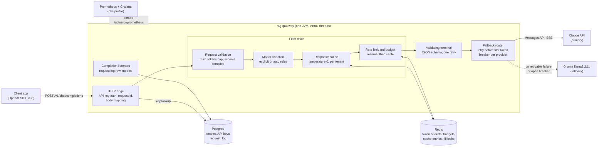

# rag-gateway

An LLM gateway with an OpenAI-compatible `POST /v1/chat/completions` endpoint, built in Java 21 and Spring Boot 3. A RAG endpoint on top of it is the next milestone (see [Status](#status)).

## What it is

One service between applications and LLM providers, so that limits, failures, cost and keys are handled once instead of in every app. An app switches to it by changing its OpenAI base URL.

On every chat request the gateway:

- authenticates the API key and resolves the tenant (the tenant never comes from the body);
- validates the request, including the caller's JSON schema;
- picks the model (`"model": "auto"` uses size-based routing rules);
- serves exact repeats of `temperature: 0` requests from a per-tenant Redis cache;
- enforces a per-tenant token bucket (429 with `Retry-After`) and a monthly budget;
- calls the provider with timeouts, retries before the first token, a circuit breaker per provider and a fallback chain (Claude, then a local Ollama model);
- validates the output against the caller's JSON schema when one is given;
- streams the answer as OpenAI-style SSE, then writes one cost row per request to Postgres and records Prometheus metrics.

### Status

| Part | State |
|---|---|
| Gateway path (t01–t07): auth, rate limit, budget, cost log, fallback, metrics, cache, routing, output validation | Built and tested (JUnit 5 + Testcontainers, WireMock providers) |
| Benchmarks (t08) | Harness built in this round; the measured table below fills from the committed run |
| RAG path (t09–t13): ingestion, hybrid retrieval, ACL filtering, evals | Not built yet |

## Quickstart

Needs Docker and a JDK 21. This runs against WireMock mock providers (the `mock` compose profile and the `bench` Spring profile), so no API key is needed.

<!-- quickstart:begin -->
```bash
docker compose --profile mock up -d --wait
./gradlew bootRun --args='--spring.profiles.active=bench'
export RGW_KEY=$(scripts/seed-demo.sh | awk '$1 == "acme" && $2 == "admin" { print $NF }')
curl -sS http://localhost:8080/v1/chat/completions -H "Authorization: Bearer $RGW_KEY" -H 'Content-Type: application/json' -d '{"model":"auto","messages":[{"role":"user","content":"Say hi"}]}'
```
<!-- quickstart:end -->

`bootRun` stays in the foreground; run the last two commands in a second terminal once it logs `Started`. `scripts/seed-demo.sh` creates two tenants and three keys and prints the keys once; only their SHA-256 is stored.

Against the real Claude API instead: copy `.env.example` to `.env`, set `GATEWAY_CLAUDE_API_KEY`, export it in the shell that runs the app, start the stack with `docker compose up -d` (Postgres and Redis only) and run `./gradlew bootRun` without the `bench` profile. The fallback needs a local Ollama with `llama3.2:1b` pulled.

`bash scripts/quickstart_check.sh` runs exactly the four commands above on a clean clone and expects a 200.

## Architecture



### Request path

1. **Auth (edge).** `Authorization: Bearer <key>`; the key's SHA-256 is looked up in Postgres. Unknown key: 401, no provider call.
2. **Body mapping and validation.** OpenAI request to the internal request; unsupported fields (`tools`, `n` ≠ 1, images) are a 400. `max_tokens` is capped and a `json_schema` response format must compile.
3. **Model selection.** An explicit model must be in the catalog and allowed for the tenant (400 or 403). `auto` goes through ordered routing rules; the chosen rule is in `X-Gateway-Route-Rule`.
4. **Cache.** Only `temperature: 0` without `X-Gateway-Cache-Bypass: true` is eligible. The key holds the tenant, the resolved model, the messages, the sampling parameters and the schema. A hit is replayed and never touches the limiter. A cold key is filled by one request holding a Redis lock while the others wait.
5. **Rate limit and budget.** Reserve `input estimate + max_tokens` from the tenant's token bucket (Lua script in Redis): denied is 429 `rate_limited` with `Retry-After`. Month-to-date spend at or over the budget is 429 `budget_exceeded`. After the call, unused tokens are refunded and the cost is added, exactly once, in a `finally` block.
6. **Router.** Per provider: `Retry(CircuitBreaker(call))`, retrying only before the first token with full-jitter backoff; on a retryable failure or an open breaker, the next provider in the chain. Timeouts (connect, first token, idle gap) live in the adapters.
7. **Output validation.** With a schema, each router call is buffered, checked (schema, truncation, refusal), retried once, and sent as one burst or a 502 `invalid_model_output`. Without one, tokens stream straight through; a structural check per attempt turns an empty `stop` answer into a retryable failure.
8. **Response, log, metrics.** SSE or JSON to the client with `X-Request-Id`, `X-Gateway-Provider`, `X-Gateway-Model`, `X-Gateway-Cache`. After the response is closed, one `request_log` row (tokens, cost, provider, cache status, attempts) and the request metrics.

## API examples

Streaming chat (any OpenAI client works the same way):

```bash
curl -N http://localhost:8080/v1/chat/completions \
  -H "Authorization: Bearer $RGW_KEY" -H 'Content-Type: application/json' \
  -d '{"model":"claude-haiku-5-5","stream":true,"stream_options":{"include_usage":true},
       "messages":[{"role":"user","content":"Say hi"}]}'
```

Routed model, cacheable (`temperature: 0`), headers shown:

```bash
curl -sS -D - http://localhost:8080/v1/chat/completions \
  -H "Authorization: Bearer $RGW_KEY" -H 'Content-Type: application/json' \
  -d '{"model":"auto","temperature":0,"messages":[{"role":"user","content":"Name a prime number"}]}'
# X-Gateway-Route-Rule: short   X-Gateway-Model: claude-haiku-5-5   X-Gateway-Cache: MISS, then HIT on a repeat
```

Structured output, validated against the caller's schema (a non-conforming answer is retried once, then 502):

```bash
curl -sS http://localhost:8080/v1/chat/completions \
  -H "Authorization: Bearer $RGW_KEY" -H 'Content-Type: application/json' \
  -d '{"model":"claude-opus-5-5","messages":[{"role":"user","content":"Capital of France as JSON"}],
       "response_format":{"type":"json_schema","json_schema":{"name":"city","schema":{
         "type":"object","required":["city"],"properties":{"city":{"type":"string"}}}}}}'
```

Usage and cost of the caller's tenant (dates are UTC days, `to` exclusive; default: this month):

```bash
curl -sS "http://localhost:8080/v1/usage?from=2026-11-01&to=2026-12-01" -H "Authorization: Bearer $RGW_KEY"
# {"tenant_id":"acme","from":"2026-11-01","to":"2026-12-01","requests":..,"input_tokens":..,"output_tokens":..,"cost_usd":".."}
```

OpenAI Python SDK:

```python
import os
from openai import OpenAI
client = OpenAI(base_url="http://localhost:8080/v1", api_key=os.environ["RGW_KEY"])
for chunk in client.chat.completions.create(model="auto", stream=True,
                                            messages=[{"role": "user", "content": "Say hi"}]):
    print(chunk.choices[0].delta.content or "", end="")
```

Errors are OpenAI-shaped JSON (`{"error":{"message","type","code","request_id"}}`) before the first byte, and an SSE `error` event after it. Main codes: 401 bad key, 400 invalid request, 403 `model_not_allowed`, 429 `rate_limited` (with `Retry-After`) or `budget_exceeded`, 502 `invalid_model_output`, 503 `all_providers_failed`.

`bash scripts/demo.sh` runs the main behaviours end to end against the mock profile: a 429 with `Retry-After`, a cache hit, a fallback with the Claude mock stopped, a schema-validated answer and `/v1/usage`, printing what each step expects and what it got.

## Designed for

Design assumptions and targets from the [HLD](docs/HLD.md) and DECISIONS C2. **None of these is a measurement**, and nothing here is evidence that the gateway reaches them.

<!-- designed-for:begin -->
| Quantity | Assumption or target | Source |
|---|---|---|
| Average request rate | ~300 requests/s | C2 |
| Peak request rate | ~900 requests/s | C2 |
| Requests in flight at peak | ~4K (900 req/s × ~4.5 s per streamed answer) | C2 |
| Output tokens at peak | ~450K tokens/s (900 × ~500) | C2 |
| Gateway added latency before the first token | target < 50 ms p99 | HLD non-functional requirements |
| Cache-hit latency | target p99 < 200 ms | project brief, WORK_PLAN t08 |
| Availability | target 99.9 %, survives one provider outage | HLD non-functional requirements |
<!-- designed-for:end -->

The binding constraints at that scale are concurrency and tokens, not request rate: that is why requests run on virtual threads and limits are counted in tokens.

## Measured

Every value below is read from a committed run file, `bench/summary/<Run>.json`, at the key in the last column; `python3 scripts/check_readme_numbers.py` fails if any value, label or key disagrees. A row reading "pending" has no number yet.

How to read it:

- **Hardware.** "cloud container, 4 vCPU / 15 GB" runs the gateway, the WireMock mocks and k6 on the same host, sharing its CPUs. That inflates latency and caps throughput, so these numbers say what the gateway adds on that machine, not how it behaves against real providers (the mocks have fixed latency and never rate-limit). Laptop runs are added as their own rows by the owner and replace nothing.
- **Setup.** App with `-Xmx512m` and virtual threads; k6 `grafana/k6:2.3.0` with an open arrival-rate model for latency scenarios and a closed model for open streams (D-45).
- **Percentiles.** "k6 client-side" percentiles are computed by k6 from every request. "bucket edges" percentiles come from a Prometheus histogram and are interpolated inside the bucket that holds them (D-38); the row lists the edges.
- **Two overhead numbers (D-39).** "Added latency seen by the client" is gateway minus direct-to-mock at the same arrival rate (time to first byte and total). "Gateway processing overhead" excludes provider time and deliberate waits such as retry backoff. They answer different questions and are never merged.
- **Cost** is modelled from list prices on a synthetic workload, not billed.

<!-- measured:begin -->
| Metric | Value | Unit | Measured on | Run | Source key |
|---|---|---|---|---|---|
| Overhead: requests through the gateway | pending | requests | cloud container, 4 vCPU / 15 GB | | `scenarios.overhead.requests` |
| Added latency seen by the client, time to first byte, p50 (k6 client-side) | pending | ms | cloud container, 4 vCPU / 15 GB | | `scenarios.overhead.added_latency_seen_by_client_ms.ttfb.p50` |
| Added latency seen by the client, time to first byte, p95 (k6 client-side) | pending | ms | cloud container, 4 vCPU / 15 GB | | `scenarios.overhead.added_latency_seen_by_client_ms.ttfb.p95` |
| Added latency seen by the client, time to first byte, p99 (k6 client-side) | pending | ms | cloud container, 4 vCPU / 15 GB | | `scenarios.overhead.added_latency_seen_by_client_ms.ttfb.p99` |
| Added latency seen by the client, total time, p50 (k6 client-side) | pending | ms | cloud container, 4 vCPU / 15 GB | | `scenarios.overhead.added_latency_seen_by_client_ms.total.p50` |
| Added latency seen by the client, total time, p95 (k6 client-side) | pending | ms | cloud container, 4 vCPU / 15 GB | | `scenarios.overhead.added_latency_seen_by_client_ms.total.p95` |
| Added latency seen by the client, total time, p99 (k6 client-side) | pending | ms | cloud container, 4 vCPU / 15 GB | | `scenarios.overhead.added_latency_seen_by_client_ms.total.p99` |
| Gateway processing overhead p50 (`gateway_overhead_seconds`, bucket edges 1, 2, 5, 10, 25, 50, 100, 250, 500, 1000 ms) | pending | ms | cloud container, 4 vCPU / 15 GB | | `scenarios.overhead.gateway_processing_overhead_ms.p50` |
| Gateway processing overhead p95 (`gateway_overhead_seconds`, bucket edges 1, 2, 5, 10, 25, 50, 100, 250, 500, 1000 ms) | pending | ms | cloud container, 4 vCPU / 15 GB | | `scenarios.overhead.gateway_processing_overhead_ms.p95` |
| Gateway processing overhead p99 (`gateway_overhead_seconds`, bucket edges 1, 2, 5, 10, 25, 50, 100, 250, 500, 1000 ms) | pending | ms | cloud container, 4 vCPU / 15 GB | | `scenarios.overhead.gateway_processing_overhead_ms.p99` |
| Cache-hit latency p50 (k6 client-side) | pending | ms | cloud container, 4 vCPU / 15 GB | | `scenarios.cache_hit_latency.p50_ms` |
| Cache-hit latency p95 (k6 client-side) | pending | ms | cloud container, 4 vCPU / 15 GB | | `scenarios.cache_hit_latency.p95_ms` |
| Cache-hit latency p99 (k6 client-side) | pending | ms | cloud container, 4 vCPU / 15 GB | | `scenarios.cache_hit_latency.p99_ms` |
| Cache-hit latency: requests | pending | requests | cloud container, 4 vCPU / 15 GB | | `scenarios.cache_hit_latency.requests` |
| Cache hit rate: configured repeat share of the workload | pending | % | cloud container, 4 vCPU / 15 GB | | `scenarios.cache_hit_rate.configured_repeat_share` |
| Cache hit rate: measured | pending | % | cloud container, 4 vCPU / 15 GB | | `scenarios.cache_hit_rate.measured_hit_rate` |
| Cache hit rate: requests | pending | requests | cloud container, 4 vCPU / 15 GB | | `scenarios.cache_hit_rate.requests` |
| Cost per 1,000 requests, baseline: explicit strong model, no cache (modelled from list prices on a synthetic workload) | pending | USD | cloud container, 4 vCPU / 15 GB | | `scenarios.cost_per_1k.baseline_usd` |
| Cost per 1,000 requests, cache only (modelled from list prices on a synthetic workload) | pending | USD | cloud container, 4 vCPU / 15 GB | | `scenarios.cost_per_1k.cache_usd` |
| Cost per 1,000 requests, routing only (modelled from list prices on a synthetic workload) | pending | USD | cloud container, 4 vCPU / 15 GB | | `scenarios.cost_per_1k.routing_usd` |
| Cost per 1,000 requests, cache and routing (modelled from list prices on a synthetic workload) | pending | USD | cloud container, 4 vCPU / 15 GB | | `scenarios.cost_per_1k.cache_and_routing_usd` |
| Cost: requests per run | pending | requests | cloud container, 4 vCPU / 15 GB | | `scenarios.cost_per_1k.requests_per_run` |
| Fallback: Claude mock killed at (seconds after the run started) | pending | s | cloud container, 4 vCPU / 15 GB | | `scenarios.fallback.primary_killed_at_s` |
| Fallback: requests after the kill | pending | requests | cloud container, 4 vCPU / 15 GB | | `scenarios.fallback.requests_after_kill` |
| Fallback: success rate after the kill | pending | % | cloud container, 4 vCPU / 15 GB | | `scenarios.fallback.success_rate_after_kill` |
| Fallback: added latency after the kill, p50 (k6 client-side) | pending | ms | cloud container, 4 vCPU / 15 GB | | `scenarios.fallback.added_latency_ms.p50` |
| Fallback: added latency after the kill, p95 (k6 client-side) | pending | ms | cloud container, 4 vCPU / 15 GB | | `scenarios.fallback.added_latency_ms.p95` |
| Fallback: added latency after the kill, p99 (k6 client-side) | pending | ms | cloud container, 4 vCPU / 15 GB | | `scenarios.fallback.added_latency_ms.p99` |
| Rate limit: over-limit requests | pending | requests | cloud container, 4 vCPU / 15 GB | | `scenarios.rate_limit.over_limit_requests` |
| Rate limit: over-limit requests answered 429 with `Retry-After` | pending | requests | cloud container, 4 vCPU / 15 GB | | `scenarios.rate_limit.with_429_and_retry_after` |
| Rate limit: share answered correctly | pending | % | cloud container, 4 vCPU / 15 GB | | `scenarios.rate_limit.share_correct` |
| Rate limit: admitted tokens per minute | pending | tokens/min | cloud container, 4 vCPU / 15 GB | | `scenarios.rate_limit.admitted_tokens_per_min` |
| Rate limit: configured limit | pending | tokens/min | cloud container, 4 vCPU / 15 GB | | `scenarios.rate_limit.limit_tokens_per_min` |
| Redis refused from start: added latency p50 (k6 client-side) | pending | ms | cloud container, 4 vCPU / 15 GB | | `scenarios.redis_down_from_start.refused.added_ms.p50` |
| Redis refused from start: added latency p95 (k6 client-side) | pending | ms | cloud container, 4 vCPU / 15 GB | | `scenarios.redis_down_from_start.refused.added_ms.p95` |
| Redis refused from start: added latency p99 (k6 client-side) | pending | ms | cloud container, 4 vCPU / 15 GB | | `scenarios.redis_down_from_start.refused.added_ms.p99` |
| Redis refused from start: errors | pending | errors | cloud container, 4 vCPU / 15 GB | | `scenarios.redis_down_from_start.refused.errors` |
| Redis black-holed from start: added latency p50 (k6 client-side) | pending | ms | cloud container, 4 vCPU / 15 GB | | `scenarios.redis_down_from_start.blackholed.added_ms.p50` |
| Redis black-holed from start: added latency p95 (k6 client-side) | pending | ms | cloud container, 4 vCPU / 15 GB | | `scenarios.redis_down_from_start.blackholed.added_ms.p95` |
| Redis black-holed from start: added latency p99 (k6 client-side) | pending | ms | cloud container, 4 vCPU / 15 GB | | `scenarios.redis_down_from_start.blackholed.added_ms.p99` |
| Redis black-holed from start: errors | pending | errors | cloud container, 4 vCPU / 15 GB | | `scenarios.redis_down_from_start.blackholed.errors` |
| Open streams: largest N with zero errors | pending | streams | cloud container, 4 vCPU / 15 GB | | `scenarios.open_streams.max_n_zero_errors` |
| Headers delayed past the first-token timeout: concurrent requests | pending | requests | cloud container, 4 vCPU / 15 GB | | `scenarios.open_streams.headers_delayed.n` |
| Headers delayed: errors | pending | errors | cloud container, 4 vCPU / 15 GB | | `scenarios.open_streams.headers_delayed.errors` |
| Headers delayed: fallback success rate | pending | % | cloud container, 4 vCPU / 15 GB | | `scenarios.open_streams.headers_delayed.fallback_success_rate` |
| Headers delayed: peak heap used | pending | MB | cloud container, 4 vCPU / 15 GB | | `scenarios.open_streams.headers_delayed.peak_heap_used_mb` |
| Headers delayed: peak virtual threads | pending | threads | cloud container, 4 vCPU / 15 GB | | `scenarios.open_streams.headers_delayed.peak_virtual_threads` |
| Request-log insert p50 (`gateway_requestlog_write_seconds`, bucket edges 0.5, 1, 2, 5, 10, 25, 50, 100 ms) | pending | ms | cloud container, 4 vCPU / 15 GB | | `scenarios.log_insert.p50_ms` |
| Request-log insert p99 (`gateway_requestlog_write_seconds`, bucket edges 0.5, 1, 2, 5, 10, 25, 50, 100 ms) | pending | ms | cloud container, 4 vCPU / 15 GB | | `scenarios.log_insert.p99_ms` |
| Request-log insert: inserts | pending | count | cloud container, 4 vCPU / 15 GB | | `scenarios.log_insert.count` |
<!-- measured:end -->

Per-N open-stream rows (errors, peak heap, peak virtual threads, pinned-thread reports at each N) are added from the run with keys such as `scenarios.open_streams.runs[n=1000].errors`.

## Trade-offs

| Choice | Taken | Rejected, and why | Decision |
|---|---|---|---|
| Rate-limit algorithm | Token bucket in one Lua script; reserve `input estimate + max_tokens`, settle to actual | Sliding-window log (memory grows with traffic); fixed window (2× burst at the edge) | C5 |
| Redis down | Fail open: per-instance in-memory bucket, budget check skipped, cache reads as a miss | Fail closed (one Redis outage takes every LLM call down) | D-17 |
| Cache key | Tenant + resolved model + messages + sampling params + schema; `stream` left out | Cross-tenant sharing (higher hit rate, leaks answers); `stream` in the key (halves hits) | D-40 |
| What is cached | Complete primary answers only, `temperature: 0` only | Caching fallback answers (a 1B answer served for the whole TTL) or refusals | C21, D-40 |
| Fallback trigger | Retryable errors and timeouts, plus an open breaker; config faults (401/403/404) move on without retry | Retrying config faults; a hand-written breaker next to Resilience4j | D-07, D-37 |
| Retries mid-stream | Only before the first token reached the client | Retrying after tokens were sent (the client would see duplicated text) | D-07 |
| Output validation vs streaming | Buffer only when a schema is given; one retry; 502 after | Validate after streaming (bad output already sent); JSON repair (hides model errors) | C8, D-43 |
| Cost logging | One insert per request after the response is closed | In-memory batch buffer (loss window and shutdown draining for no measured need yet) | C7 |
| Concurrency model | Spring MVC on virtual threads, blocking code | WebFlux end to end (harder to write and debug for the same I/O-bound scaling) | D-03 |

## Limitations

- **Temperature is not sent to Claude (D-05).** On the API version the SDK uses, a Messages request with `temperature` or `top_p` is rejected, so the gateway forwards them to Ollama only. For Claude, `temperature: 0` is not a determinism guarantee: the cache rule "only `temperature: 0` is cached" is a contract with the caller ("I accept a stored answer"), not a promise that the model would have answered the same way.
- **One price tier per model (D-08).** Prices are configuration with one input and one output price per model. Haiku prompts above 100K tokens are priced higher by the provider and are under-costed here; requests in this project stay far below that.
- **Redis down means fail open (D-17).** With Redis unreachable each instance falls back to its own in-memory bucket, so N instances admit up to N × the tenant's limit, and spend during the outage is not added to the budget. A black-holed Redis host (not refused) costs up to the connect timeout per Redis call; the benchmark's "Redis black-holed" rows measure it and decide whether a short skip window is needed.
- **A budget of 0 blocks every request (D-36).** The check is `spent >= budget`, so a zero budget means a suspended tenant, not "unlimited".
- **Percentiles from histograms are estimates (D-38).** Server-side p50/p95/p99 are interpolated inside the bucket that holds them; a p99 that falls between two edges is only known to lie in that bucket. Each row in the measured table names its bucket edges or says it is k6 client-side.
- **Schema requests are buffered (D-43).** A request with a `json_schema` response format gets no token streaming: its time to first byte is its full generation time, plus a second call when the first answer is invalid. A provider failure in the middle of a buffered call is not retried by the router; the client gets a 502.
- **Budget overshoot is bounded, not zero (C22).** The budget is checked before the call and charged after it, so a tenant can overshoot by its requests in flight × the cost of one request.
- **The benchmark measures the gateway against mocks**, with load generator, mocks and gateway on one host (D-45). It says nothing about real provider latency or provider-side rate limits.

## How to reproduce

```bash
./gradlew clean build                                                   # unit + integration tests (Docker needed)
bash bench/run-all.sh --measured-on "<hardware label>"                  # all scenarios; writes bench/summary/<run_id>.json
python3 scripts/check_readme_numbers.py                                 # README measured table == run files
bash scripts/quickstart_check.sh && bash scripts/demo.sh && bash scripts/check_mermaid.sh
python3 -B -m unittest discover -s scripts/tests -v                        # tests of the checks themselves
```

`--measured-on` is required and has no default, so a run cannot be mislabelled. Raw k6 output stays in the gitignored `bench/results/`; the summary file is committed. The observability stack (`docker compose --profile obs up -d`) adds Prometheus and Grafana with the dashboard in `ops/grafana/dashboards/`.

## Docs

- [Roadmap](docs/ROADMAP.md): scope, task plan, stack, hardware constraints
- [High-level design](docs/HLD.md): requirements, estimates, API, deep dives
- [Low-level design](docs/LLD.md): classes, filter chain, limiter, breaker, router, cache
- [Concepts and trade-offs](docs/CONCEPTS.md)
- [Architecture decisions](docs/process/DECISIONS.md): every choice with its rejected alternative
- [Work plan](docs/process/WORK_PLAN.md) and [team rules](docs/process/TEAM_RULES.md)
